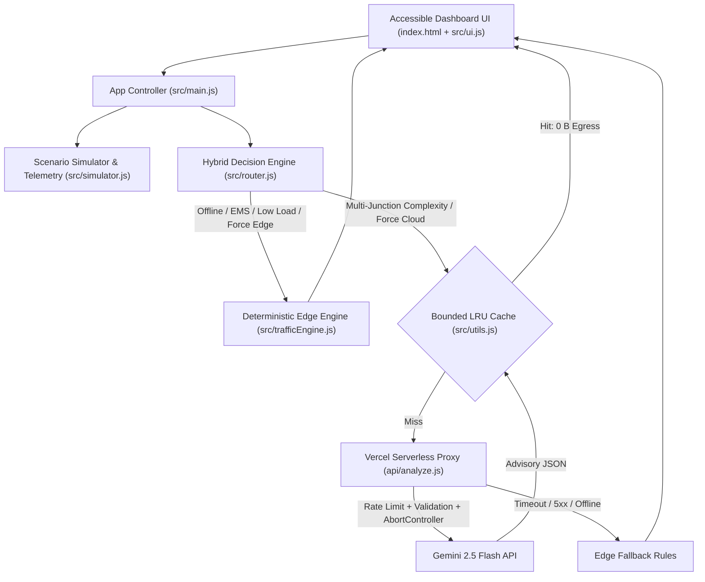

# CorridorFlow AI — Smart Traffic Management System

A production-grade, **Hybrid Edge + Cloud** Smart Traffic Management System built with zero-build-overhead modular ES6 JavaScript, Vercel Serverless Functions, Gemini Cloud AI forecasting, and WCAG 2.1 AA accessibility.

---

## Chosen Vertical & Personas

- **Vertical**: Urban Arterial & Corridor Traffic Operations
- **Primary Personas**:
  1. **Traffic Control Operators (TCOs)** — Monitor multi-junction queue lengths, adjust routing policies (`Auto Hybrid`, `Force Edge`, `Force Cloud AI`), and dispatch incident advisories.
  2. **Emergency Responders (EMS / Fire)** — Require deterministic, zero-latency green-corridor preemption without waiting on cloud round-trips.
  3. **Daily Commuters** — Benefit from reduced intersection wait times, smoother green-wave progression, and lower fuel/CO2 emissions.

---

## Problem Statement -> Solution Mapping

| Requirement | Implementation | Key Files |
| :--- | :--- | :--- |
| Adaptive Urban Signal Control | Queue-weighted green-wave timing with progressive offsets and fail-safe flash | [`src/trafficEngine.js`](src/trafficEngine.js), [`src/config.js`](src/config.js) |
| Emergency Vehicle Preemption | Instant deterministic Edge override locking EMS green corridor (`60s` NS green, `6s` offsets) | [`src/router.js`](src/router.js), [`src/trafficEngine.js`](src/trafficEngine.js) |
| Hybrid Edge + Cloud Efficiency | Local Edge handles normal/EMS/offline loads (`0 B` egress); Cloud AI invoked only for multi-junction complexity | [`src/router.js`](src/router.js), [`src/utils.js`](src/utils.js) |
| Bounded Caching & Resilience | LRU-style `BoundedCache` + fallback chain: Cache -> Edge -> `/api/analyze` -> Edge Fallback | [`src/utils.js`](src/utils.js), [`src/trafficEngine.js`](src/trafficEngine.js) |
| Secure Cloud AI Proxy | Vercel serverless function with `POST`-only, per-IP rate limiting, `AbortController`, and input bounds | [`api/analyze.js`](api/analyze.js), [`vercel.json`](vercel.json), [`SECURITY.md`](SECURITY.md) |
| Accessible Operator Dashboard | Semantic landmarks, `aria-live="polite"`, `>= 44px` targets, `prefers-reduced-motion`, XSS-safe `textContent` | [`index.html`](index.html), [`styles.css`](styles.css), [`src/ui.js`](src/ui.js) |
| Automated Verification | Vitest + `jsdom` + `@vitest/coverage-v8` unit & integration suites | [`tests/`](tests/) |

---

## Hybrid Edge + Cloud Decision Logic

`decideRoute()` in `src/router.js` evaluates corridor context in strict priority order:

1. **Connectivity Check**: If `!navigator.onLine` or **Simulate Offline Backhaul** is enabled -> **Edge** (`OFFLINE_EDGE`, `0 B` egress).
2. **Emergency Preemption**: If any junction reports `hasEmergency` or incident notes match EMS/fire/ambulance -> **Edge** (`EMERGENCY_PREEMPTION`, zero network latency).
3. **Operator Policy Override**: `Force Edge` -> **Edge** (`POLICY_FORCE_EDGE`); `Force Cloud AI` -> **Cloud** (`POLICY_FORCE_CLOUD`).
4. **Auto Hybrid Complexity Gate**: Escalates to **Cloud AI** (`MULTI_CORRIDOR_COMPLEXITY`) only when `>= 2` junctions exceed `22` queued vehicles, a signal fault occurs, or complex weather/accident notes are entered. Otherwise runs locally on **Edge** (`LOCAL_OPTIMAL_EDGE`).

---

## Architecture Diagram



---

## Assumptions Made

- **Corridor Topology**: Models a 4-junction arterial corridor (`MG Road & 1st Ave`, `Central Civic Square`, `Tech Park Junction`, `Ring Road Bypass`) with `320m` nominal spacing for green-wave offset calculation.
- **Zero-Build Deployment**: Uses native browser ES6 modules (`"type": "module"`) so the app deploys directly on Vercel without a bundler step, while keeping strict CSP (`script-src 'self'`).
- **Rate Limiter Scope**: `api/analyze.js` uses an in-memory per-IP `Map` suitable for single-instance serverless warm containers; for multi-region distributed enforcement, an external store (e.g., Upstash Redis) can be plugged into `checkRateLimit`.

---

## Running Locally & Testing

```bash
# 1. Install devDependencies (Vitest, jsdom, coverage-v8)
npm install

# 2. Configure environment (optional for local static preview; required for /api/analyze)
cp .env.example .env.local

# 3. Run unit & integration tests
npm test

# 4. Run tests with V8 coverage report
npm run test:coverage

# 5. Serve locally
npm start
```
